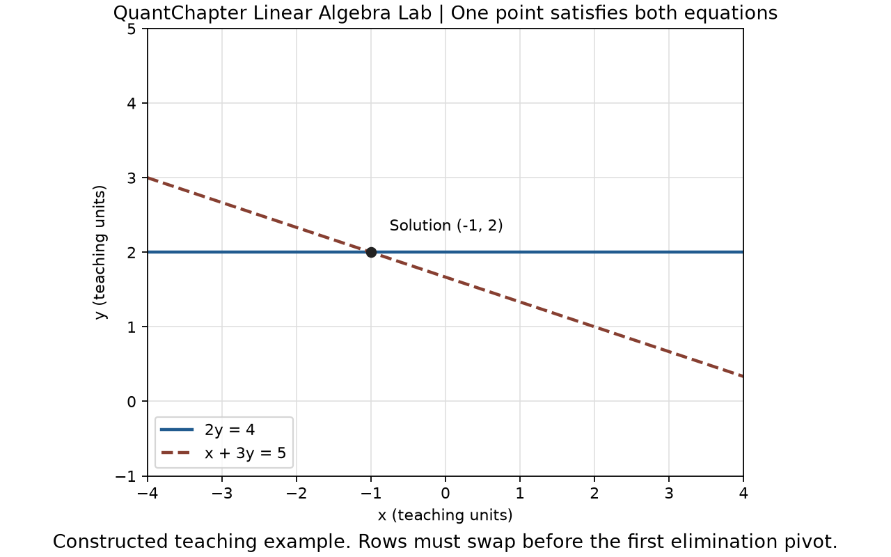

# QuantChapter Linear Algebra Lab

A small, typed Python solver that makes elimination, row swaps and numerical
checks inspectable. **No runtime dependencies, network calls or API keys.**
Python 3.11–3.14 is supported.

The first release focuses on finite square systems with a unique numerical
solution. It provides partial-pivot Gaussian elimination, immutable results,
residuals and a relative backward-error diagnostic. It deliberately exposes
numerical limits instead of silently claiming that every input can be solved.

## Start with a system that needs a row swap

From a cloned checkout:

```shell
python -m venv .venv
# Activate the environment using your shell, then:
python -m pip install .
```

PowerShell activation is `.venv\Scripts\Activate.ps1`; macOS/Linux activation
is `source .venv/bin/activate`. The environment's Python can also be used directly.

```python
from quantchapter_linear_algebra import solve

result = solve([[0, 2], [1, 3]], [4, 5])
print(tuple(round(value, 8) for value in result.solution))  # (-1.0, 2.0)
print(result.residual)  # (0.0, 0.0)
print(result.row_swaps)  # 1
```

The first equation gives `y = 2`. Substituting into the second gives
`x + 6 = 5`, so `x = -1`. The original first pivot is zero; swapping the rows
puts a usable coefficient first without changing either equation's meaning.

## Run the complete example

```shell
quantchapter-linear-algebra data/row_swap_system.json
quantchapter-linear-algebra data/row_swap_system.json --output artifacts/report.json
python examples/solve_fixture.py
```

The CLI accepts UTF-8 JSON with exactly `matrix` and `rhs` arrays. The versioned
report records the exact input SHA-256 digest, solution, residual, row swaps,
pivot tolerance and backward error. Input is bounded to 20 MiB and dimension 256.
Malformed, duplicate-key, nonfinite and nonsquare inputs fail explicitly.
Output is atomic and existing files are retained unless `--force` is supplied.
`python -m quantchapter_linear_algebra` provides the same CLI.

For the optional figure:

```shell
python -m pip install ".[plot]"
python examples/plot_system.py
```



The figure uses the same constructed fixture as the solver. Both lines meet at
the point that satisfies both original equations. See the [worked tutorial](docs/tutorial.md)
for the elimination steps, a fresh practice case and complete comparisons.

## Numerical contract

- Finite real coefficients and right-hand sides; booleans and strings are rejected.
- Nonempty square matrices of dimension 1–256, copied without input mutation.
- Global normalization by the largest absolute matrix coefficient.
- Partial row pivoting selects the largest absolute available coefficient.
- A normalized pivot of magnitude at most `rtol` is rejected; default `rtol=1e-12`.
- Residual is `b - A*x`; its reported norm is the maximum absolute component.
- Relative backward error is `||r||∞ / (||A||∞ ||x||∞ + ||b||∞)`.

The pivot threshold is scale-aware but is **not a condition-number estimate**.
Small residuals and backward errors do not guarantee small solution errors for
ill-conditioned systems. `rtol=0` relaxes pivot rejection without guaranteeing
accuracy. Unsafe normalization, arithmetic overflow and unrepresentable
diagnostics fail rather than returning infinities. Read the full
[API and numerical conventions](docs/api.md) before using a new input class.

## Engineering and verification

The repository includes an independent exact-rational oracle, property-based
tests, numerical edge cases, CLI failure tests, strict type checking and a 95%
branch-coverage gate. The development dependencies are locked, CI actions are
pinned, and the workflow tests the declared Python/OS matrix and a fresh wheel
installation outside the source checkout.

Use [CONTRIBUTING.md](CONTRIBUTING.md) for reproducible checks,
[SECURITY.md](SECURITY.md) for private reports, and
[the release process](docs/release-process.md) for publication evidence.
Passing software checks does not establish learner effectiveness or suitability
for an engineering, financial or safety-critical deployment.

## About QuantChapter

QuantChapter is being built as a quantitative education platform connecting
mathematics, statistics, programming, finance and research. This free companion
project demonstrates the connection between mathematical reasoning and tested
Python implementations. Its teaching is authored and unpiloted. The platform's
paid checkout remains closed; this repository has no payment or account flow.

Questions: [open an issue](https://github.com/QuantChapter/quantchapter-linear-algebra-lab/issues).
Private reports and business contact: [support@quantchapter.com](mailto:support@quantchapter.com).
Original code, documentation and the constructed fixture use the [MIT license](LICENSE).
